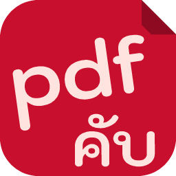

  

# PdfCraft TH

เวอร์ชันภาษาไทยของ [PdfCraft](https://github.com/storytold/pdfcraft) โปรแกรม PDF โอเพนซอร์สที่เขียนด้วย Rust

A Thai edition of PdfCraft, an open-source PDF application written in Rust.

> **This is an unofficial, modified version.** It is based on PdfCraft by the ArtCraft team and
> the PdfCraft contributors. It was not made, sponsored or endorsed by them. Support for this
> edition belongs here, not with the original project.

## สิ่งที่ต่างจากต้นฉบับ / What is different

- **แสดงภาษาไทยได้** ชื่อไฟล์ เมนู และช่องพิมพ์ใช้ font ที่มีอยู่ในเครื่อง ไม่ได้ฝัง font ไว้ในโปรแกรม
  Thai in the interface, drawn with a font already installed on the machine.
- **เขียนไทยลง PDF ได้** Add Text และ Edit Text วางสระและวรรณยุกต์ถูกตำแหน่ง ฝังเฉพาะ font ที่ประกาศสัญญาอนุญาตแบบเปิด
  (Sarabun, Noto Sans Thai) ลงในไฟล์ PDF เท่านั้น ไม่ใช้ Tahoma หรือ font ที่มากับ Word
  Thai in Add Text and Edit Text, written only with openly licensed fonts (OFL, Apache, MIT).
- **เปิด PDF ไทยที่ไม่ฝัง font ได้** ใช้ font ในเครื่องแสดงบนจอเท่านั้น ไม่ใช้ตอนพิมพ์หรือ export
  PDFs that don't embed their Thai font draw with an installed one, on screen only.
- ไอคอนมีป้าย **TH** / the app icon carries a **TH** badge.
- เอาชื่อและโลโก้ ArtCraft การ์ดชวนเข้าชุมชน และปุ่ม Discord ออก
  The ArtCraft name and logos, the community card and the Discord button are removed.

ยังไม่รองรับ / Not yet: ไทยใน comment และ form field ยังเป็น `?`, และยังไม่เคย build บน Windows
(Thai in comments and form fields still shows `?`; Windows has never been built).

## Build and sync

[CUSTOM.md](CUSTOM.md) has the build steps, the sync steps from the original project, and the
checks to run after a merge. This file is this edition's own: a merge keeps it
(`git config merge.ours.driver true`, see CUSTOM.md).

## License

MIT OR Apache-2.0, at your option: [LICENSE-MIT](LICENSE-MIT), [LICENSE-APACHE](LICENSE-APACHE).
Copyright (c) 2026 ArtCraft Team and the PdfCraft contributors. Required notices are in
[NOTICE](NOTICE). The ArtCraft name, wordmark and logos are trademarks of the ArtCraft Team, are
not open source and are not part of this edition.
