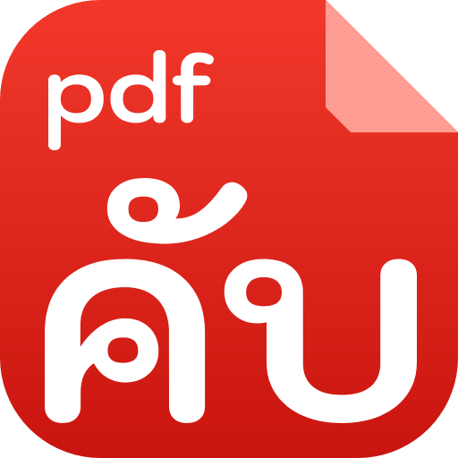

# pdfคับ app icon



**Design:** the tile itself is a red page with its top right corner folded, carrying the word pdfคับ in pale pink:
pdf large across the page and tilted up 8 degrees, คับ small under the rising end of the word. Red is the colour people already expect of a PDF.
Plain polygons only, so the SVG and every PNG come from the same shapes.

**Palette:** red `#c8102e`, pale pink `#ffe3de`, fold `#8e0a20`.

**Tile:** `viewBox="0 0 512 512"`, corners `r=112`. Windows and Linux icons are full bleed. macOS icons put it on
Apple's grid (an 824 px body centred on a transparent 1024 px canvas).

**Provenance:** original artwork for this edition, made with Claude. The word is traced from Kodchasan Bold
(SIL OFL 1.1) and stored in `packaging/thai/logo-glyphs.json`. Licence: [LICENSE.txt](LICENSE.txt)
(`MIT OR Apache-2.0`, like the repo). The upstream lion icon is not used here.

## Files

| File | What it is |
|---|---|
| `pdfcraft.svg` | the master vector; every PNG, `.ico` and `.icns` is rendered from the same shapes |
| `pdfcraft-small.svg` | a copy of the master, used by the About window and this README |
| `pdfcraft-1024.png` | 1024 px on Apple's grid; also the runtime Dock icon on macOS |
| `pdfcraft.icns` | macOS icon (16–1024 px) |
| `pdfcraft.ico` | Windows icon (16–256 px), embedded in `pdfcraft.exe` by `apps/pdfcraft/build.rs` |
| `pdfcraft-document.svg` | Windows PDF file icon master: a Lucide document outline, red badge and outlined PDF lettering; no font dependency |
| `pdfcraft-document.ico` | Windows PDF file icon (16–256 px), embedded as resource 2 in `pdfcraft.exe` |
| `hicolor/<n>x<n>/apps/ai.storyteller.pdfcraft.png` | Linux hicolor theme, 16–512 px; the 256 px one is the runtime icon on Windows and Linux |
| `hicolor/scalable/apps/ai.storyteller.pdfcraft.svg` | Linux scalable icon (copy of the master) |

Where it shows: `apps/pdfcraft/src/main.rs` sets the window icon (Dock, taskbar, Alt-Tab, launcher) and the
Wayland app id `ai.storyteller.pdfcraft`; `packaging/linux/ai.storyteller.pdfcraft.desktop` names the
hicolor icon.

Windows PDF files use resource 2 (`"pdfcraft.exe",-2`) when PdfCraft is chosen as the default
reader; the app keeps resource 1. The document outline is adapted from Lucide `file-text`
1.49.0 (ISC); its badge and outlined lettering are original (`MIT OR Apache-2.0`), covered by
[LICENSE-document.txt](LICENSE-document.txt). Both icons are embedded, requiring no runtime
sidecar. This provides a file type icon; first-page thumbnails still need a thumbnail provider.

## Regenerate

```sh
python3 packaging/thai/make-logo.py          # needs Pillow; iconutil (macOS) for the .icns
cargo xtask assets --write                   # make-logo.py already updated the sha256 values in ATTRIBUTION.toml
```

`--trace` first re-traces the word from Kodchasan Bold (macOS keeps it among its system fonts); without it the
stored outlines are used, so the font is not needed.
